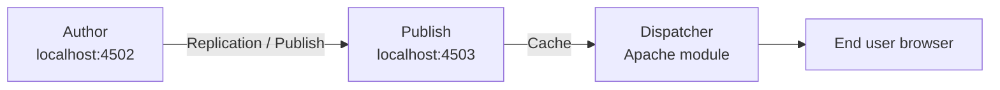

# AEM Learning Guide — Skoda AEM Learning

A step-by-step, beginner-friendly guide to understand this project: how AEM runs, where
everything lives in CRXDE, what is on your local instance, and where to change things by hand.

> This guide is grounded in **this** project (`skodaaemlearning`). Paths and names below are the
> real ones you will see in your repo and in CRXDE/AEM.

---

## 1. The big picture — Author, Publish, Dispatcher

AEM is made of separate running services. Content flows left → right:



| Service | Local URL | What it is for |
| ------- | --------- | -------------- |
| **Author** | `http://localhost:4502` | Where authors log in and create/edit pages, upload assets, configure templates. This is the "editing" environment. |
| **Publish** | `http://localhost:4503` | A copy of approved content, served to the public. Authors never edit here. |
| **Dispatcher** | (Apache + module) | A caching/security layer in front of Publish. Config lives in [dispatcher/](dispatcher). Validated with `cd dispatcher && ./bin/validate.sh src`. |

**Content flow (publishing):**
1. Author creates/edits a page on **Author**.
2. Author clicks **Publish** → AEM *replicates* the page+assets to **Publish**.
3. **Dispatcher** caches the published HTML and serves it fast to visitors.
4. To remove content, author uses **Unpublish** (reverse replication).

In **AEM as a Cloud Service** (what this project targets) you don't start author/publish by hand in
production — Adobe runs them. Locally you use a single **Quickstart SDK jar** (the
`aem-author-p4502.jar` you have been starting in the terminal) to simulate Author.

---

## 2. Author vs. Publish vs. your local SDK

- The `crx-quickstart/` folder in this repo is the **unpacked local AEM SDK instance** (its
  repository, logs, launchpad). It is the running author server's data — not something you edit by hand.
- You deploy your code into it with Maven:
  ```bash
  mvn clean install -PautoInstallSinglePackage
  ```
  This builds all modules and installs the `all` package into the instance at `localhost:4502`.

---

## 3. CRXDE Lite — where everything lives

CRXDE Lite is the repository browser: `http://localhost:4502/crx/de`. The repository is one big tree
(the JCR). These are the top-level folders that matter and **what you find in each**:

| Repository path | Purpose | In this project you'll find |
| --------------- | ------- | --------------------------- |
| `/apps` | **Your application code** — components, templates overrides, clientlibs. Deployed from `ui.apps`. | `/apps/skodaaemlearning/components`, `/apps/skodaaemlearning/clientlibs` |
| `/conf` | **Editable templates, policies, config** per site. Deployed from `ui.content`. | `/conf/skodaaemlearning/settings/wcm/templates` (page-content, landing-page, xf-web-variation) |
| `/content` | **Actual pages** authors create (the site content tree). | `/content/skodaaemlearning/us/en` |
| `/content/dam` | **Digital Asset Manager** — images, PDFs, videos. | `/content/dam/skodaaemlearning/asset.jpg` |
| `/content/experience-fragments` | Reusable chunks (header, footer) shared across pages. | `/content/experience-fragments/skodaaemlearning/us/en/site/header` and `/footer` |
| `/libs` | **Adobe's product code** (and Core Components). **Never edit** — read-only. | Core Components, AEM internals |
| `/etc.clientlibs` | Public URL path where compiled CSS/JS clientlibs are served. | `/etc.clientlibs/skodaaemlearning/clientlibs/...` |

**Rule:** You put your code in `/apps` and `/conf`. Authors' work lives in `/content`. Adobe owns
`/libs` (to change Adobe behavior you *overlay* into `/apps`, never edit `/libs`).

### Where this project maps from repo → CRXDE

| Maven module | Deploys to repository | 
| ------------ | --------------------- |
| [ui.apps](ui.apps) | `/apps/skodaaemlearning` (components, clientlibs) |
| [ui.content](ui.content) | `/conf/skodaaemlearning` (templates) + `/content/...` (sample pages, DAM) |
| [ui.config](ui.config) | `/apps/skodaaemlearning/osgiconfig` (OSGi runtime config) |
| [core](core) | OSGi bundle (Java: Sling models, servlets, filters) |
| [ui.frontend](ui.frontend) | Compiled CSS/JS → copied into `ui.apps` clientlibs |

---

## 4. Components — overlay vs. override vs. custom

A **component** is a reusable building block (title, text, image, hero…). It lives under
`/apps/skodaaemlearning/components`. There are three ways to get one:

### a) Custom component (built from scratch)
You write the HTL + dialog + (optionally) a Sling model yourself. This project's custom components:

- **Hero** — [components/hero/hero.html](ui.apps/src/main/content/jcr_root/apps/skodaaemlearning/components/hero/hero.html),
  dialog [hero/_cq_dialog](ui.apps/src/main/content/jcr_root/apps/skodaaemlearning/components/hero/_cq_dialog/.content.xml),
  logic [HeroModel.java](core/src/main/java/com/skodaaem/aem/core/models/HeroModel.java).
- **Hello World** — [components/helloworld/helloworld.html](ui.apps/src/main/content/jcr_root/apps/skodaaemlearning/components/helloworld/helloworld.html) (archetype sample).

### b) Proxy component (the normal way to use Core Components)
A tiny component in `/apps` whose `sling:resourceSuperType` points at an Adobe **Core Component** in
`/libs`. You inherit all its behavior and just set the group/styling. Most components here are proxies:
`text`, `teaser`, `carousel`, `navigation`, `breadcrumb`, `list`, `embed`, etc.

### c) Overlay vs. Override (changing Adobe/inherited behavior)
- **Overlay** = copy a node from `/libs` into the same path under `/apps` to *replace* Adobe's version
  repository-wide. Used sparingly. (You never edit `/libs` directly.)
- **Override** = for a single component, change behavior via `sling:resourceSuperType` (inherit) and
  then supply your own files for only the parts you want to change (e.g. your own `hero.html` while
  keeping the Core Component logic).

**Quick mental model:**
- *Custom* → brand-new component you own fully.
- *Proxy/Override* → inherit a Core Component, tweak a bit.
- *Overlay* → replace an Adobe `/libs` feature globally (advanced, rare).

---

## 5. Templates — the blueprint for pages

A page is created *from a template*. Editable templates live in
`/conf/skodaaemlearning/settings/wcm/templates`. This project has:

| Template | Purpose |
| -------- | ------- |
| `page-content` | Standard content page (the homepage uses this). |
| `landing-page` | A landing-page layout. |
| `xf-web-variation` | Experience Fragment web variation (for header/footer). |

Each template has three parts:
- **structure** — locked components always present (e.g. header/footer).
- **initial** — what a brand-new page starts with.
- **policies** — which components are *allowed* and their default settings (design).

Edit templates in the UI at: **Tools → General → Templates →** `skodaaemlearning`.

---

## 6. Creating a page (step by step, in Author)

1. Go to **AEM Start → Sites**: `http://localhost:4502/sites.html/content/skodaaemlearning/us/en`
2. Select the parent page → **Create → Page**.
3. Pick a **template** (e.g. *page-content*), give it a **Title**, click **Create**.
4. **Open** the new page → the **Page Editor** opens.
5. Drag components from the **left rail (Components)** onto the page.
6. Click a component → the toolbar **wrench/Configure** icon opens its **dialog**; fill in text,
   pick images, etc.
7. Preview with the top-right **Preview** toggle.
8. When ready, use **Page Information → Publish Page** to push it to Publish.

---

## 7. Assets (DAM) — step by step

1. Go to **AEM Start → Assets → Files**: `http://localhost:4502/assets.html/content/dam/skodaaemlearning`
2. **Create → Files** (or drag-drop) to upload an image/PDF.
3. AEM generates renditions (thumbnails/sizes) automatically.
4. Reference the asset from a component dialog (e.g. Hero image, Image component) by browsing to
   its DAM path, e.g. `/content/dam/skodaaemlearning/asset.jpg`.

> The existing `asset.jpg` is sample content from the project archetype. It is safe to delete or reuse.

---

## 8. What is on your local AEM right now

### Components (under `/apps/skodaaemlearning/components`)
Custom: **hero**, **helloworld**.
Proxies of Core Components: page, xfpage, text, teaser, carousel, navigation, languagenavigation,
breadcrumb, list, search, embed, contentfragment, experiencefragment, tableofcontents, separator,
pdfviewer, progressbar, form/text, form/button.

### Sites (under `/content/skodaaemlearning`)
- `/content/skodaaemlearning` → `us` → `en` (the homepage). Open it at
  `http://localhost:4502/editor.html/content/skodaaemlearning/us/en.html`.

### DAM (under `/content/dam/skodaaemlearning`)
- `asset.jpg` (sample).

### Experience Fragments (header/footer)
- `/content/experience-fragments/skodaaemlearning/us/en/site/header`
- `/content/experience-fragments/skodaaemlearning/us/en/site/footer`

### Clientlibs (CSS/JS)
- `/apps/skodaaemlearning/clientlibs/clientlib-base`, `clientlib-grid` (+ the compiled
  `clientlib-dependencies`/`clientlib-site` coming from [ui.frontend](ui.frontend)).

---

## 9. Where to change things by hand (e.g. the text)

There are **two kinds** of changes — know which one you want:

### A) Change *content* (the words/images on a specific page) — done by authors
This is **not** in code. It is stored under `/content`. Change it via the **Page Editor**:
1. Open `http://localhost:4502/editor.html/content/skodaaemlearning/us/en.html`
2. Click the text/teaser/component → **Configure (wrench)** → edit the text → **Done**.
3. (Optional) **Publish** the page.

The raw content also exists in the repo as sample content at
[ui.content/.../us/en/.content.xml](ui.content/src/main/content/jcr_root/content/skodaaemlearning/us/en/.content.xml),
but for real editing use the Author UI, not the XML.

### B) Change *code/markup/behavior* (how a component renders) — done by developers
Edit the files in the repo, then redeploy.

| What you want to change | File to edit | Redeploy command |
| ----------------------- | ------------ | ---------------- |
| Hero markup/structure | [hero.html](ui.apps/src/main/content/jcr_root/apps/skodaaemlearning/components/hero/hero.html) | `mvn clean install -pl ui.apps -PautoInstallPackage` |
| Hero fields (dialog) | [hero/_cq_dialog/.content.xml](ui.apps/src/main/content/jcr_root/apps/skodaaemlearning/components/hero/_cq_dialog/.content.xml) | `mvn clean install -pl ui.apps -PautoInstallPackage` |
| Hero Java logic | [HeroModel.java](core/src/main/java/com/skodaaem/aem/core/models/HeroModel.java) | `mvn clean install -pl core -PautoInstallBundle` |
| Global styles (CSS/SCSS) | [ui.frontend/src/main/webpack](ui.frontend/src/main/webpack) | `cd ui.frontend && npm run build` then build `ui.apps` |
| Hero component styles | [hero/clientlib](ui.apps/src/main/content/jcr_root/apps/skodaaemlearning/components/hero/clientlib/.content.xml) | `mvn clean install -pl ui.apps -PautoInstallPackage` |
| OSGi runtime config | [ui.config](ui.config) | `mvn clean install -pl ui.config -PautoInstallPackage` |

**Full redeploy (everything):**
```bash
mvn clean install -PautoInstallSinglePackage
```

> Tip: Static text that appears *inside the HTL* (hard-coded labels like the Hero's "configure
> headline & image" placeholder) is a **code** change (edit `hero.html`). Text that an author typed
> into a dialog is **content** (edit via Page Editor).

---

## 10. Frontend preview vs. AEM — why they look different

- `cd ui.frontend && npm start` serves a **static mock** page
  ([static/index.html](ui.frontend/src/main/webpack/static/index.html)). It is hand-written sample
  markup, only for working on CSS/JS quickly. It never reflects real content.
- The **AEM page** (`localhost:4502/.../en.html`) is rendered live from HTL components + templates +
  authored content. **This is the source of truth.**

---

## 11. Handy local URLs

| Action | URL |
| ------ | --- |
| AEM Start | `http://localhost:4502` |
| CRXDE Lite (repository) | `http://localhost:4502/crx/de` |
| Sites console | `http://localhost:4502/sites.html/content/skodaaemlearning` |
| Edit homepage | `http://localhost:4502/editor.html/content/skodaaemlearning/us/en.html` |
| Published homepage | `http://localhost:4502/content/skodaaemlearning/us/en.html` |
| Assets (DAM) | `http://localhost:4502/assets.html/content/dam/skodaaemlearning` |
| Templates | `http://localhost:4502/libs/wcm/core/content/sites/templates.html/conf/skodaaemlearning` |
| OSGi console | `http://localhost:4502/system/console/bundles` |

---

## 12. Glossary (quick)

- **HTL** — HTML Template Language; AEM's templating used in `.html` files (replaces JSP).
- **Sling Model** — a Java class that supplies data to HTL (`data-sly-use`). E.g. `HeroModel`.
- **Clientlib** — a bundle of CSS/JS served under `/etc.clientlibs`.
- **Policy / Design** — which components are allowed on a template and their default settings.
- **Replication** — the mechanism that copies content from Author to Publish (Publish/Unpublish).
- **Experience Fragment (XF)** — reusable authored content block (header, footer) shared by pages.
